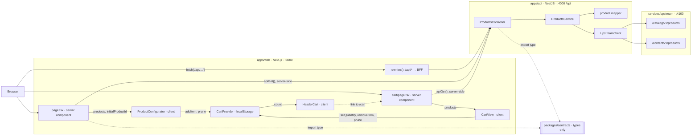

# Architecture

The current architecture, kept in step with the code as the storefront is built. It extends [`base-architecture.md`](base-architecture.md), which stays as the starting snapshot before any implementation. For an interactive version, with simulated upstream latency and failures, open [`architecture.html`](architecture.html).

## Products endpoint

`GET /api/products` returns `ProductsResponse` (`@saatva/contracts`): one merged list with price, image, rating and description, and no trace of which upstream a field came from.

- Catalog and content are fetched in parallel and joined on the trimmed, lowercased handle, which becomes the product `id`.
- The catalog decides what is sellable: content-only and discontinued products are dropped.
- `priceCents` is what the shopper pays; `compareAtPriceCents` is the list price when a valid sale applies.
- Upstream values are validated at runtime (cents and ratings may arrive as strings); description HTML is sanitized with an allowlist.
- Catalog failure or timeout: `503`. Content failure: `200` with the content fields `null` / `[]`.

## Configurator page

`app/page.tsx` is an async server component. It reads `?product=`, loads the list with `apiGet<ProductsResponse>('/api/products')` and renders the client component `ProductConfigurator`. The browser never calls the BFF for this page.

- **Selection** is a native radio group styled as a segmented control. The chosen id is state in the component and is mirrored to the URL with `history.replaceState` (no server round trip, no history entry per click). A missing or unknown `?product=` falls back to the first product, so links are shareable and a refresh keeps the choice.
- **Content fields** (`headline`, `rating`, `descriptionHtml`, `badges`) are hidden when `null` / empty, so the page still works when the BFF returns the degraded `200`.
- **Description HTML** is rendered only by `components/RichText.tsx`, which trusts the BFF's allowlist sanitization. It is the single `dangerouslySetInnerHTML` in the web app.
- **Loading** is `app/loading.tsx`, a skeleton with the same grid as the configurator. **Failure** (BFF `503`, network error or an empty list) renders `ProductsUnavailable` with a "Try again" link; the error is logged on the server only.
- **Layout** is one CSS grid: two columns from 768px, stacked below it (title, selector, image, details, button).
- **Prices** are formatted in `lib/format.ts` from the BFF's integer cents; the web app never computes prices.
- `apps/web` imports `@saatva/contracts` with `import type` only.

## Cart

The cart lives in the browser's `localStorage` (key `saatva.cart.v1`); there is no cart endpoint and no database (C3). A line is `{ productId, quantity }` only, so names, images and prices are always joined from `/api/products` and totals always use current prices (sale price where active).

- `lib/cart.ts` is pure: `parseCart` (corrupt JSON or shape → empty cart, bad lines dropped, quantities clamped to 1–10, duplicate ids merged), `addLine`, `setLineQuantity` (clamps 1–10), `removeLine`, `pruneCart`, `priceCart` (joins lines with BFF products, integer cents, skips unknown ids), `cartCount`, and try/catch `readCart` / `writeCart`. If storage is unavailable or full, the cart stays in memory for the session and a warning is logged.
- `components/CartProvider.tsx` (in the root layout) is an external store read with `useSyncExternalStore`. The server snapshot is an empty cart, so hydration matches; the `storage` event syncs other tabs. `useCart()` exposes `cart`, `count`, `hydrated`, `addItem` (`'added' | 'max'`), `prune` (a no-op for an empty id list, so a failed catalog never wipes the cart), `setQuantity` and `removeItem`.
- `HeaderCart` (client) is a link to `/cart` and shows the badge only when hydrated and the count is above 0; `Header` stays a server component and the logo links to `/`.
- `/cart` (`app/cart/page.tsx`, dynamic) fetches `/api/products` like the home page and renders the client `CartView`; if products fail to load it renders `CartUnavailable` and the stored cart is untouched. `CartView` shows a skeleton until hydrated (so a full cart never flashes "empty"), prunes on mount, then lists lines (`QuantityStepper`: − [n] + with min 1, max 10, typing commits valid values and clamps or reverts on blur/Enter; separate Remove) and a summary (items, subtotal, a "calculated at checkout" note). Changes are announced in an `aria-live` region, and after Remove focus moves to the neighbouring line's Remove button or the empty-state heading. There is no checkout button.
- `ProductConfigurator` adds the selected mattress, announces the result in an `aria-live` status, and prunes unknown ids on mount. Cap: 10 per line.
- Trade-offs for the C3 discussion: per browser only, the server can't render the count, and a real checkout must re-price server-side. A BFF-owned cart behind the same context is the upgrade path.

## Where things are

- `packages/contracts/index.d.ts`: shared response types, imported with `import type`.
- `apps/web/app/`: `page.tsx` (data), `loading.tsx`, `cart/` (`page.tsx`, `loading.tsx`), `globals.css` (tokens and all styles).
- `apps/web/components/`: `ProductConfigurator`, `PriceTag`, `StarRating`, `RichText`, `ProductsUnavailable`, `Header`, `HeaderCart`, `CartProvider`, `CartView`, `QuantityStepper`, `CartUnavailable`; `apps/web/lib/`: `api.ts`, `format.ts`, `cart.ts`.
- `apps/api/src/products/`: controller, service, `product.mapper.ts` (pure mapping functions).
- `apps/api/src/upstream/`: client (with request timeout) and provider types.

## Configuration

| Var | Default | Used by |
| --- | --- | --- |
| `API_PORT` | 4000 | api |
| `UPSTREAM_URL` | `http://localhost:4100` | api |
| `UPSTREAM_TIMEOUT_MS` | 3000 | api |
| `API_URL` | `http://localhost:4000` | web |
| `UPSTREAM_PORT`, `UPSTREAM_LATENCY_MS`, `UPSTREAM_FAILURE_RATE`, `UPSTREAM_FAIL_SERVICE` | 4100, 150, 0, none | upstream |
