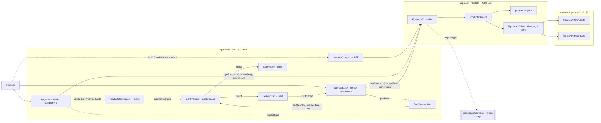

# Architecture

The current architecture, kept in step with the code as the storefront is built. It extends [`base-architecture.md`](base-architecture.md), which stays as the starting snapshot before any implementation. For an interactive version, with simulated upstream latency and failures, open [`architecture.html`](architecture.html).

## Products endpoint

`GET /api/products` returns `ProductsResponse` (`@saatva/contracts`): one merged list with price, image, rating and description, and no trace of which upstream a field came from.

- Catalog and content are fetched in parallel and joined on the trimmed, lowercased handle, which becomes the product `id`.
- The catalog decides what is sellable: content-only and discontinued products are dropped.
- `priceCents` is what the shopper pays; `compareAtPriceCents` is the list price when a valid sale applies.
- Upstream values are validated at runtime (cents and ratings may arrive as strings); description HTML is sanitized with an allowlist.
- Catalog failure or timeout: `503`. Content failure: `200` with the content fields `null` / `[]`.

## Failure handling

| Layer | Behaviour |
| --- | --- |
| `UpstreamClient` | Per-attempt timeout `UPSTREAM_TIMEOUT_MS` (2000). Connection errors and 5xx are retried once after 150 ms; a timeout is never retried (it would double the wait). The worst case is a slow 5xx followed by a timed-out retry, about 2 × timeout + 150 ms (~4.15 s), still under the web's 5 s timeout; keep `UPSTREAM_TIMEOUT_MS` below ~2.4 s. A body that isn't JSON or the documented shape (catalog `data` array and a three-letter `meta.currency` code, since the web's `Intl.NumberFormat` throws on anything else; content array) counts as an upstream failure. Each failed attempt is logged with its number. |
| `ProductsService` | Catalog failure → `503`. Content failure → products without copy. Only status `active` (trimmed, any case) sells. Entries that aren't objects, have no handle, a blank name or an image key that isn't a plain slug are skipped and logged, like an unreadable price; for duplicate handles the first wins. |
| Error body | Nest's built-in exception handling: `{ statusCode, message, error }` for HTTP errors, including unknown routes (404); anything unexpected becomes a plain 500 with no stack trace. No custom filter. |
| `apiGet` (web) | `AbortSignal.timeout(5000)`, longer than the BFF's worst case. `getProducts()` also rejects a body without a `products` array, so the pages show their unavailable message instead of crashing. Timeout, BFF unreachable and HTTP status are told apart in the thrown message, which is only logged. |
| Pages | Products unavailable → `ProductsUnavailable` / `CartUnavailable` (the alert role is on the message, not the whole section). Unexpected render errors → `app/error.tsx` ("Try again" calls `router.refresh()` and `reset()` in a transition, so server data is fetched again). Unknown URLs → `app/not-found.tsx`. |
| Loading | Skeletons (`role="status"` with hidden "Loading…" text) stay invisible for 300 ms, then fade in, so fast navigations show nothing. With reduced motion they appear without the fade. |

| Scenario | BFF | Shopper sees |
| --- | --- | --- |
| Catalog down (`UPSTREAM_FAIL_SERVICE=catalog`) | `503` after one retry | "Our mattresses are taking a nap" / "We can't show your cart right now" |
| Content down (`UPSTREAM_FAIL_SERVICE=content`) | `200`, copy `null` / `[]` | Configurator without headline, rating, description, badges |
| Flaky (`UPSTREAM_FAILURE_RATE=0.5`) | Retry turns ~50% failures into ~25% per service | Mostly the normal page |
| Slow (`UPSTREAM_LATENCY_MS=5000`) | `503` at ~2 s (timeout, no retry) | Unavailable message after ~2 s |
| Malformed upstream body | Catalog → `503`; content → `200` without copy | As above |
| BFF down or hung | — | Unavailable message (immediately, or after 5 s) |
| Unknown URL | `404` JSON for `/api/*` | Friendly 404 page |

## Configurator page

`app/page.tsx` is an async server component. It reads `?product=`, loads the list with `getProducts()` (`lib/api.ts`, a thin wrapper over `apiGet` that checks for a `products` array) and renders the client component `ProductConfigurator`. The browser never calls the BFF for this page.

- **Selection** is a native radio group styled as a segmented control. The chosen id is state in the component and is mirrored to the URL with `history.replaceState` (no server round trip, no history entry per click). A missing or unknown `?product=` falls back to the first product, so links are shareable and a refresh keeps the choice.
- **Content fields** (`headline`, `rating`, `descriptionHtml`, `badges`) are hidden when `null` / empty, so the page still works when the BFF returns the degraded `200`.
- **Description HTML** is rendered only by `components/RichText.tsx`, which trusts the BFF's allowlist sanitization. It is the single `dangerouslySetInnerHTML` in the web app.
- **Loading** is `app/loading.tsx`, a skeleton with the same grid as the configurator. **Failure** (BFF `503`, network error or an empty list) renders `ProductsUnavailable` with a "Try again" link; the error is logged on the server only.
- **Layout** is one CSS grid: two columns from 768px, stacked below it (title, selector, image, details, button).
- **Images** were normalized once to 1268×698 (2× the 634×349 frame), cropped so the bed sits at the same size and position in each (originals in git history); the frame and cart thumbnails use the same ratio, so CSS never crops them.
- **Contrast.** Fills that carry white text are darkened from the mock to reach WCAG AA: button `#8f6a3f` (4.9:1), badge `#8e6553` (5.1:1), selected segment `#736e67` (5.1:1). Tokens are in `globals.css`.
- **Prices** are formatted in `lib/format.ts` from the BFF's integer cents; the web app never computes prices.
- `apps/web` imports `@saatva/contracts` with `import type` only.

## Cart

The cart lives in the browser's `localStorage` (key `saatva.cart.v1`); there is no cart endpoint and no database (C3). A line is `{ productId, quantity }` only, so names, images and prices are always joined from `/api/products` and totals always use current prices (sale price where active).

- `lib/cart.ts` is pure: `parseCart` (corrupt JSON or shape → empty cart, bad lines and quantities ≤ 0 dropped, quantities capped at 10, duplicate ids merged), `addLine`, `setLineQuantity` (clamps 1–10, ignores NaN), `removeLine`, `pruneCart`, `priceCart` (joins lines with BFF products, integer cents, skips unknown ids), `cartCount`, and try/catch `readCart` / `writeCart`. If storage is unavailable or full, the cart stays in memory for the session and a warning is logged.
- `components/CartProvider.tsx` (in the root layout) is an external store read with `useSyncExternalStore`. The server snapshot is an empty cart, so hydration matches; the `storage` event syncs other tabs. `useCart()` exposes `cart`, `count`, `hydrated`, `addItem` (`'added' | 'max'`), `prune` (a no-op for an empty id list, so a failed catalog never wipes the cart; returns the number of units removed), `setQuantity`, `removeItem` (returns whether a line was removed), and `notice` / `dismissNotice`. Pages prune through `usePruneCart(products)`.
- **Retired products.** When `prune` drops lines it sets a one-time notice, "1 item is no longer available and was removed from your cart" (counted in units, like the badge; plural aware), shown by `CartNotice` under the header in a persistent status region with a dismiss button (focus moves to `<main>` on dismiss). Lines store only ids, so the product can't be named. The notice is React state, so only the tab that pruned shows it.
- `HeaderCart` (client) is a 44×44 px link to `/cart` and shows the badge only when hydrated and the count is above 0; `Header` stays a server component and the logo links to `/`.
- `/cart` (`app/cart/page.tsx`, dynamic) fetches `/api/products` like the home page and renders the client `CartView`; if products fail to load it renders `CartUnavailable` and the stored cart is untouched. `CartView` shows a skeleton until hydrated (so a full cart never flashes "empty"), prunes on mount, then lists lines (`QuantityStepper`: − [n] + with min 1, max 10, typing commits valid values and clamps or reverts on blur/Enter; separate Remove) and a summary (items, subtotal, a "calculated at checkout" note). Changes are announced in one `aria-live` region that stays mounted across the empty and populated states (an identical repeated message is not re-announced; accepted). After Remove focus moves to the neighbouring line's Remove button or the empty-state heading (and nothing is queued if the remove was a no-op). When − or + disables at 1 or 10, focus moves to the quantity input instead of falling to `<body>`, and a half-typed draft is dropped if the quantity changes elsewhere. There is no checkout button.
- `ProductConfigurator` adds the selected mattress, announces the result in an `aria-live` status, and prunes unknown ids on mount. Cap: 10 per line.
- Trade-offs for the C3 discussion: per browser only, the server can't render the count, and a real checkout must re-price server-side. A BFF-owned cart behind the same context is the upgrade path.

## Where things are

- `packages/contracts/index.d.ts`: shared response types, imported with `import type`.
- `apps/web/app/`: `page.tsx` (data), `loading.tsx`, `error.tsx`, `not-found.tsx`, `cart/` (`page.tsx`, `loading.tsx`), `globals.css` (tokens and all styles).
- `apps/web/components/`: `ProductConfigurator`, `PriceTag`, `StarRating`, `RichText`, `ProductsUnavailable`, `Header`, `HeaderCart`, `CartProvider`, `CartView`, `CartNotice`, `QuantityStepper`, `CartUnavailable`; `apps/web/lib/`: `api.ts` (`apiGet`, `getProducts`), `format.ts`, `cart.ts`.
- `apps/web/next.config.mjs`: the `/api/*` rewrite to the BFF. Today every page loads its data server-side, so no client code goes through it; it is there for client fetches and for hitting the BFF from the browser (e.g. `/api/health`).
- `apps/api/src/main.ts` (global prefix `/api`, `API_PORT`), `app.module.ts`, `health.controller.ts` (`GET /api/health` → `{ status: 'ok' }`).
- `apps/api/src/products/`: controller, service (fetch both upstreams, join, decide what sells), `product.mapper.ts` (pure functions: handle normalizing, pricing, ratings, sanitized description).
- `apps/api/src/upstream/`: client (timeout, one retry, shape check) and provider types.

## Configuration

| Var | Default | Used by |
| --- | --- | --- |
| `API_PORT` | 4000 | api |
| `UPSTREAM_URL` | `http://localhost:4100` | api |
| `UPSTREAM_TIMEOUT_MS` | 2000 (per attempt) | api |
| `API_URL` | `http://localhost:4000` | web |
| `UPSTREAM_PORT`, `UPSTREAM_LATENCY_MS`, `UPSTREAM_FAILURE_RATE`, `UPSTREAM_FAIL_SERVICE` | 4100, 150, 0, none | upstream |
