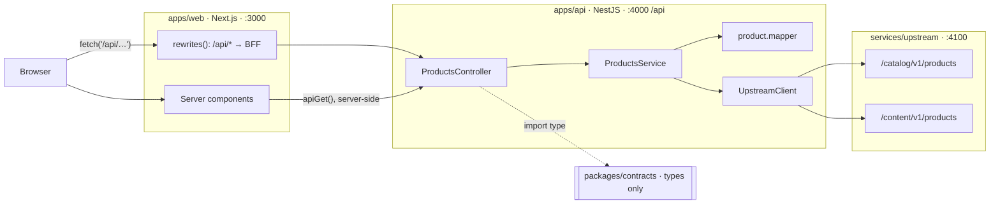

# Architecture

The current architecture, kept in step with the code as the storefront is built. It extends [`base-architecture.md`](base-architecture.md), which stays as the starting snapshot before any implementation. For an interactive version, with simulated upstream latency and failures, open [`architecture.html`](architecture.html).

## Products endpoint

`GET /api/products` returns `ProductsResponse` (`@saatva/contracts`): one merged list with price, image, rating and description, and no trace of which upstream a field came from.

- Catalog and content are fetched in parallel and joined on the trimmed, lowercased handle, which becomes the product `id`.
- The catalog decides what is sellable: content-only and discontinued products are dropped.
- `priceCents` is what the shopper pays; `compareAtPriceCents` is the list price when a valid sale applies.
- Upstream values are validated at runtime (cents and ratings may arrive as strings); description HTML is sanitized with an allowlist.
- Catalog failure or timeout: `503`. Content failure: `200` with the content fields `null` / `[]`.

## Where things are

- `packages/contracts/index.d.ts`: shared response types, imported with `import type`.
- `apps/api/src/products/`: controller, service, `product.mapper.ts` (pure mapping functions).
- `apps/api/src/upstream/`: client (with request timeout) and provider types.

## Configuration

| Var | Default | Used by |
| --- | --- | --- |
| `API_PORT` | 4000 | api |
| `UPSTREAM_URL` | `http://localhost:4100` | api |
| `UPSTREAM_TIMEOUT_MS` | 3000 | api |
| `API_URL` | `http://localhost:4000` | web |
| `UPSTREAM_PORT`, `UPSTREAM_LATENCY_MS`, `UPSTREAM_FAILURE_RATE`, `UPSTREAM_FAIL_SERVICE` | 4100, 150, 0, none | upstream |
