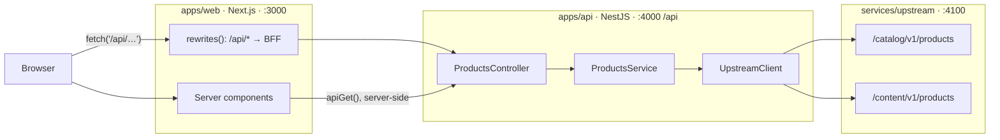

# Base architecture

The starting architecture, before any implementation work. A short map of how the pieces fit. A new architecture/plan doc will be added when building starts. For an interactive version, open [`base-architecture.html`](base-architecture.html).

## Processes

| Workspace | Port | Role |
| --- | --- | --- |
| `services/upstream` | 4100 | Mock third-party catalog + content (don't modify) |
| `apps/api` | 4000 | BFF between the web app and upstream |
| `apps/web` | 3000 | Next.js app |

## Request paths

- **Browser → BFF:** relative `/api/...` URLs, proxied by `rewrites()` in `next.config.mjs`.
- **Next server → BFF:** rewrites don't apply to server code, so `lib/api.ts#apiGet` uses the absolute `API_URL`.
- **BFF → upstream:** `UpstreamClient` fetches `UPSTREAM_URL` (`getCatalogProducts()`, `getContentProducts()`).

## Where things are

- `apps/api/src/`: `main.ts` (prefix `api`), `app.module.ts`, `health.controller.ts`, `upstream/` (client + provider types), `products/` (starting stub).
- `apps/web/`: `app/layout.tsx` (fonts, header), `app/page.tsx`, `components/Header.tsx`, `components/ProductConfigurator.tsx`, `lib/api.ts`, `public/images/`.

## Configuration

| Var | Default | Used by |
| --- | --- | --- |
| `API_PORT` | 4000 | api |
| `UPSTREAM_URL` | `http://localhost:4100` | api |
| `API_URL` | `http://localhost:4000` | web |
| `UPSTREAM_PORT`, `UPSTREAM_LATENCY_MS`, `UPSTREAM_FAILURE_RATE`, `UPSTREAM_FAIL_SERVICE` | 4100, 150, 0, none | upstream |
